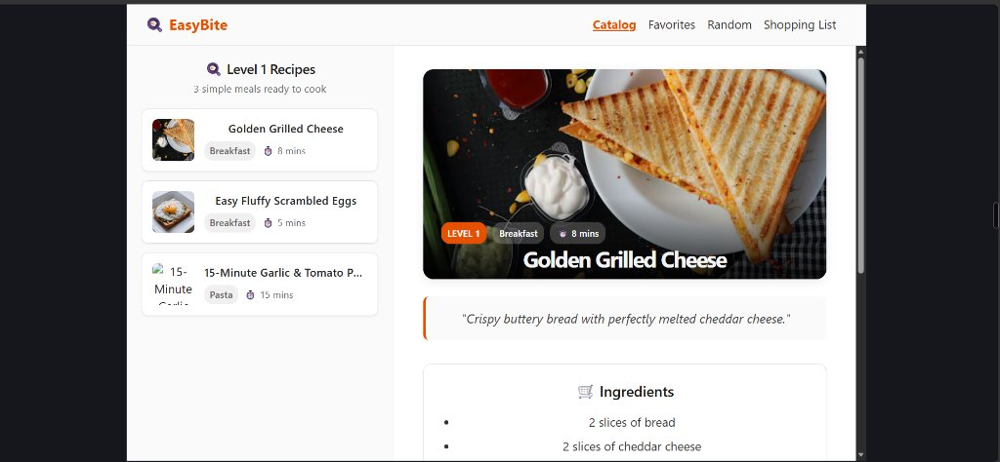

# 🍳 EasyBite — Level 1 Recipe App for Absolute Beginners

> **Final Project · Advanced Web Development Platforms & AI (Course 4255)**  
> **Lecturer:** Yariv Gilad  
> **Student:** BeRussian  
> **Status:** 100% Complete & Verified · **62 Passing Tests (100% Pass Rate)**

---



---

## 📖 Overview

**EasyBite** is a modern, responsive Single Page Application (SPA) designed for cooking beginners ("people who burn salads"). It provides quick access to fool-proof, simple Level 1 recipes fetched live from **TheMealDB API**, with intelligent client-side filtering, offline fallback resiliency, localStorage favorites persistence, a random meal decision generator, and an interactive grocery shopping to-do list.

---

## ✨ Features & Pages

| Page / Feature | Route | Description |
| :--- | :--- | :--- |
| **Catalog (Master-Detail)** | `/` & `/recipes/:id` | Two-column split-view layout. Left pane lists scrollable recipes with real-time search and category pills; right pane renders full recipe details via `<Outlet />`. |
| **Recipe Detail** | `/recipes/:id` | High-detail canvas with hero image, Level 1 difficulty badge, preparation time, ingredient checklist, and step-by-step directions. Extracts `:id` dynamically via `useParams()`. |
| **Favorites** | `/favorites` | Responsive grid displaying user-favorited recipes. Persisted in `localStorage`. Includes quick removal and a "Clear all" button. |
| **What Should I Make? (Random)** | `/random` | Instant meal decision generator with a "🎲 Roll Another Recipe" button. Intelligently excludes the currently viewed recipe so re-rolls are always fresh. |
| **Shopping To-Do List** | `/shopping-list` | Interactive grocery checklist. Automatically aggregates ingredients from favorited recipes (deduplicating identical items). Allows checking off items with strikethrough, adding custom grocery items, tracking basket progress %, and discarding items. |
| **404 Not Found** | `*` | Custom styled error fallback view with an easy one-click return to catalog. |

---

## 🏛️ Architecture & File Breakdown

The project follows a clean, modular structure where every component, utility, hook, and page has an isolated single responsibility and its own unit or integration test:

```
src/
├── types/
│   └── recipe.ts                # Strict TypeScript interface (Recipe). Zero 'any' types.
├── constants/
│   ├── recipeConstants.ts       # Fallback constants (DEFAULT_RECIPE_IMAGE).
│   └── recipeConstants.test.ts  # Verification of constant assets.
├── data/
│   ├── mockRecipes.ts           # 3 verified Level 1 recipes for offline fallback.
│   └── mockRecipes.test.ts      # Data integrity unit tests.
├── services/
│   ├── recipeApi.ts             # TheMealDB client, mapMealDBToRecipe adapter & error handling.
│   └── recipeApi.test.ts        # 8 tests: network 500 error mocks, empty payload handling.
├── utils/
│   ├── recipeUtils.ts           # Pure functions: filterRecipes, getRandomRecipe, extractShoppingList, toggleFavoriteId.
│   └── recipeUtils.test.ts      # 17 pure unit tests covering all edge cases.
├── hooks/
│   ├── useFavorites.ts          # Custom Hook: manages favorites state, localStorage sync & toast feedback.
│   └── useFavorites.test.ts     # 6 hook tests with renderHook and act.
├── components/
│   ├── Navbar.tsx               # Top navigation bar with active indicators and live favorites badge.
│   ├── RecipeCard.tsx           # Recipe card with thumbnail, category, prep time & star toggle button.
│   ├── RecipeCard.test.tsx      # 4 component tests: rendering, fallback images, star click stopPropagation.
│   ├── SearchBar.tsx            # Controlled real-time search input with clear button, category pills, live count.
│   ├── SearchBar.test.tsx       # 7 integration tests: typing keystrokes, category clicks, filters reset.
│   ├── StatusView.tsx           # Reusable loading spinner & error warning banner with retry button.
│   └── Toast.tsx                # Auto-dismissing bottom-right feedback notification ("⭐ Added to favorites").
├── pages/
│   ├── CatalogPage.tsx          # Split-view master-detail container with responsive mobile media queries.
│   ├── RecipeDetailPage.tsx     # Recipe detail view reading dynamic :id via useParams.
│   ├── FavoritesPage.tsx        # Grid view of favorited recipes with empty state.
│   ├── FavoritesPage.test.tsx   # 3 integration tests: empty state, populated grid, clear all.
│   ├── RandomRecipePage.tsx     # Instant random meal picker with dice re-roll button.
│   ├── RandomRecipePage.test.tsx# 4 integration tests: random selection, reroll, starring.
│   ├── ShoppingListPage.tsx     # Interactive to-do grocery checklist with checkboxes, progress bar, custom items.
│   └── ShoppingListPage.test.tsx# 6 integration tests: favorites aggregation, strikethrough, discarding.
├── test/
│   └── setup.ts                 # Vitest setup importing @testing-library/jest-dom matchers.
├── setup.test.ts                # Environment smoke tests.
├── App.tsx                      # Root application component orchestrating routes, API fetch, and global state.
├── index.css                    # Global CSS and responsive split-view layout media queries.
└── main.tsx                     # React 19 entry point.
```

---

## 🎯 Syllabus Requirements & Compliance Matrix

| Requirement | Syllabus Status | How EasyBite Fulfills It |
| :--- | :--- | :--- |
| **React + Vite + TypeScript** | **Mandatory** | React 19 + Vite 8 + TypeScript 5. Strict type safety with **zero `any`**. |
| **Component Count** | **Mandatory (Min 4)** | **7 standalone components** (`Navbar`, `RecipeCard`, `SearchBar`, `StatusView`, `Toast`, and 2 sub-components) + 5 page views. |
| **React Router** | **Mandatory** | Client-side routing with `NavLink`, dynamic route `/recipes/:id`, `useParams`, nested `<Outlet />`, and 404 fallback. |
| **Live API Fetch** | **Mandatory** | `fetchLiveRecipes()` calling TheMealDB API inside `useEffect` on initial render. |
| **Three Display States** | **Mandatory** | Dedicated `StatusView` component handling **Loading** (animated spinner), **Error** (retry banner), and **Data** (active views). |
| **Search & Filtering** | **Mandatory** | Real-time `SearchBar` matching titles and ingredients case-insensitively, combined with category pills. |
| **Test Suite (Vitest)** | **Mandatory (Min 5)** | **62 passing tests** across 11 test files covering unit, hook, and integration tests. |
| **Vitest UI** | **Mandatory** | Installed `@vitest/ui` with `npm run test:ui` script. |
| **Responsive Design** | **Mandatory** | CSS media queries (`@media (max-width: 768px)`) transforming two-column split view into a stacked mobile layout. |
| **Progressive Git Commits** | **Mandatory** | 10+ atomic, descriptive commits in public GitHub repository following every single task. |
| **Documentation** | **Mandatory** | `README.md`, `PRD.md`, `tasks.md`, `STUDY_GUIDE.md`, and `PROMPTS.md` fully completed. |
| **localStorage Persistence** | **Bonus** | Favorites IDs and Shopping List items persist across page refreshes and browser sessions. |
| **React Testing Library** | **Bonus** | Component integration tests using `@testing-library/react` and `jsdom`. |
| **Offline Resilience** | **Bonus** | Graceful fallback to 3 local mock recipes when external API is unreachable or blocked. |

---

## 🚀 Getting Started

### 1. Prerequisites
- **Node.js** v18+ (tested with Node 20+)
- **npm** v9+

### 2. Installation
```bash
# Clone the repository
git clone https://github.com/BeRussian/FrontEnd_FinalProject.git

# Enter project directory
cd FrontEnd_FinalProject

# Install dependencies
npm install
```

### 3. Development Server
```bash
npm run dev
```
Open your browser at `http://localhost:5074` (or `http://localhost:5173`).

### 4. Running Tests
```bash
# Run complete test suite (62 tests in ~5s)
npm test

# Run interactive Vitest UI in browser
npm run test:ui
```

### 5. Production Build
```bash
npm run build
```
Compiles TypeScript and bundles production assets into `dist/` with zero errors.

---

## 🧪 Testing Pyramid Breakdown

```
             / \
            /   \     Integration / Component Tests (30 tests)
           /-----\    @testing-library/react + jsdom: SearchBar, RecipeCard,
          /       \   FavoritesPage, RandomRecipePage, ShoppingListPage
         /---------\  
        /           \ Pure Unit Tests & Hook Tests (32 tests)
       /-------------\ Vitest: filterRecipes, recipeApi mock failure, useFavorites
```

- **Unit Tests:** Verify pure business logic (search filters, ingredient deduplication, random selection, API adapters).
- **Integration Tests:** Verify user clicks, keystroke changes, form submissions, and conditional empty states in a virtual DOM environment.

---

## 👨‍🏫 7-Minute Defense Guide (Yariv Gilad Oral Exam Cheat Sheet)

| Question | Model Answer |
| :--- | :--- |
| **"Where does state live and why?"** | *"API data and favorites live in `App.tsx` as the single source of truth because multiple routes (`Catalog`, `Favorites`, `Shopping List`, `Navbar`) need access to them. Route-specific UI states (like `searchQuery` or `newItemText`) live locally in their respective page components."* |
| **"Why use `useMemo` for filtering instead of a separate `filteredRecipes` state?"** | *"To avoid state duplication bugs. By deriving `filteredRecipes` directly from `recipes`, `searchQuery`, and `selectedCategory`, we guarantee the filtered list is always 100% in sync with zero cascading re-renders."* |
| **"How did you test API failure and offline handling?"** | *"In Vitest, we used `vi.spyOn(globalThis, 'fetch')` to simulate HTTP 500 errors and network rejection. In the browser, we demonstrated this via DevTools Network Request Blocking on `search.php`, showing the orange fallback warning banner and local mock recipes."* |
| **"Why save only recipe IDs in `localStorage` rather than full recipe objects?"** | *"Data normalization: storing IDs requires minimal storage and prevents stale data if API recipe information is updated. We simply cross-reference the IDs against the active recipe dataset."* |
| **"How did you prevent clicking the favorite star from triggering navigation in `RecipeCard`?"** | *"Using `e.stopPropagation()` and `e.preventDefault()` inside the star button's `onClick` handler. This intercepts the click event before it bubbles up to the parent `NavLink`."* |

---

## 📄 License
Created for academic evaluation in Course 4255. All recipe data provided by [TheMealDB](https://www.themealdb.com/).
